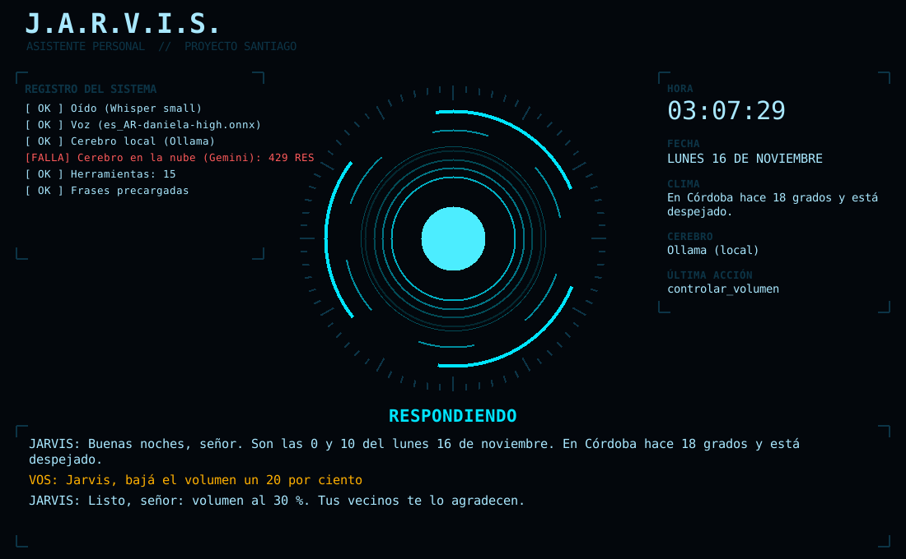

<h1 align="center">J.A.R.V.I.S.</h1>

<p align="center">
  Asistente personal por voz en español rioplatense, con cerebro híbrido (Gemini + Ollama),<br>
  <i>tool calling</i>, interfaz visual estilo Iron Man y acceso desde el celular.
</p>

<p align="center">
  <a href="https://github.com/santiagosoloaga/Jarvis/actions/workflows/ci.yml"></a>
  
  
  
</p>

<p align="center"></p>

Proyecto personal hecho en Python como parte de mi formación en robótica e IA. Lo uso todos los días: me dice la agenda, marca mis hábitos en Notion, controla mi PC y responde desde el celular. El objetivo a largo plazo es integrarlo con un brazo robótico de 6 ejes (ESP32).

## ✨ Qué hace

- 🎙️ **Manos libres:** lo llamás por su nombre ("ey Jarvis"), conversan y con "chau Jarvis" vuelve a dormir.
- 🧠 **Cerebro híbrido:** usa Gemini cuando hay internet y cupo gratis; si no, sigue funcionando 100 % local con Ollama.
- 🛠️ **23 herramientas** (*tool calling*):

| Área | Herramientas |
|---|---|
| Información | Google Noticias, Wikipedia, resumen de PDFs, consulta de planillas Excel/CSV |
| Datos al instante | Hora, clima (Open-Meteo), dólar (DolarApi), calculadora exacta |
| Productividad | Notas, recordatorios, pomodoro, Google Calendar (agendar y consultar), tracker de hábitos en Notion (marcar y consultar) |
| Control de la PC | Volumen, música, YouTube, capturas, abrir programas y sitios, bloqueo (con confirmación) |

- ⚡ **Atajos locales:** los pedidos de todos los días (hora, hábitos, abrir apps, volumen, música) se resuelven sin Gemini, casi al instante.
- 🗣️ **Voz:** Piper local por defecto; opcionalmente voz humana en la nube con Gemini TTS (con respaldo automático en Piper).
- 📱 **Desde el celular:** página web privada (Tailscale) con chat, notas de voz y capturas.
- 🖥️ **Interfaz visual:** reactor animado que reacciona a tu voz y a la de JARVIS, registro del sistema y datos en vivo.
- 🎩 **Personalidad:** mayordomo británico con humor seco, saludo con parte del día, sonidos y efecto de voz.

## 🧩 Decisiones de diseño

- **Python decide, el modelo no:** las fechas, horas y cuentas las calculan funciones deterministas (`calendario.py`, calculadora con `ast`), porque un LLM se equivoca con ellas. Tiene pruebas automáticas.
- **Rápido por defecto:** un enrutador local (`atajos.py`) resuelve lo repetido sin pasar por la nube; ante la duda devuelve `None` y decide Gemini. Mejor dudar que ejecutar algo equivocado.
- **Degradación elegante:** si se acaba la cuota o no hay internet, cambia de Gemini a Ollama; si falla la voz en la nube, vuelve a Piper.
- **Seguridad en el código, no en el prompt:** listas blancas de programas y carpetas, y las acciones delicadas piden confirmación en un mensaje nuevo, así el modelo no puede confirmarlas solo.
- **Privacidad:** tus PDFs y planillas se procesan en local por defecto; las claves viven en `.env` y nunca se suben.

## 🏗️ Arquitectura

```
 Micrófono ─► Whisper (oído) ─► atajos.py ──────────────┐
                                    │ (si no es atajo)  │
                                    ▼                   ▼
                               cerebro.py ─► Piper (voz) ─► Parlante
                                    │
                     ┌──────────────┴──────────────┐
               Gemini (nube)                 Ollama (local)
                     └──────────────┬──────────────┘
                             herramientas.py
               ┌──────────────┬─────┴──────┬───────────────┐
          control_pc.py  informacion.py  APIs web     notas / timers

 interfaz.py: ventana (hilo principal) ◄── cola de avisos ◄── JARVIS (otro hilo)
 web_jarvis.py: celular ──(Tailscale + HTTPS)──► mismos atajos y cerebro
```

| Archivo | Responsabilidad |
|---|---|
| `jarvis_wake.py` | Programa principal manos libres: detección del nombre, modo conversación, arranque |
| `interfaz.py` | Interfaz visual (tkinter) conectada por hilos y una cola de mensajes |
| `web_jarvis.py` | Servidor web para el celular: chat, notas de voz, capturas, avisos |
| `cerebro.py` | Enrutador de cerebros: Gemini con respaldo en Ollama |
| `gemini.py` | Conexión con Gemini: orden de modelos y manejo de la cuota gratis |
| `herramientas.py` | Registro de herramientas y bucle de *tool calling* para Ollama |
| `atajos.py` | Respuestas rápidas sin Gemini para los pedidos más repetidos |
| `control_pc.py` | Herramientas de control de Windows |
| `calendario.py` | Google Calendar: agendar y consultar eventos (las fechas las calcula Python) |
| `habitos.py` | Tracker de hábitos en Notion: marcar lo cumplido y consultar qué falta |
| `informacion.py` | Búsqueda de noticias, PDFs y planillas (solo en carpetas permitidas) |
| `voz_nube.py` | Voz opcional con Gemini TTS; si falla o se acaba la cuota, usa Piper |
| `jarvis_voz.py` | Oído y voz (Whisper + Piper) |
| `personalidad.py` / `efectos.py` | Personalidad y frases / sonidos sintetizados y efecto de voz |
| `jarvis_chat.py` | Versión por texto |
| `lanzador.py` / `JARVIS.bat` | Panel de botones para abrir todo |
| `JARVIS_WEB.vbs` / `DETENER_JARVIS_WEB.bat` | Arrancar y apagar la versión web en segundo plano |
| `tests/` | Pruebas automáticas (pytest) |
| `pruebas/` | Scripts de diagnóstico manual (micrófono, voces, TTS) |

## 🚀 Instalación (Windows)

Requisitos: Python 3.13, [Ollama](https://ollama.com) y Git.

```powershell
git clone https://github.com/santiagosoloaga/Jarvis.git
cd Jarvis
py install 3.13
pymanager exec -3.13 -m venv .venv
.\.venv\Scripts\Activate.ps1
pip install -r requirements.txt

ollama pull llama3.2:3b
ollama pull qwen3:4b      # solo para jarvis_chat.py (modo "calculá")
python -m piper.download_voices es_AR-daniela-high

copy .env.example .env   # y poné tu clave de Gemini (gratis)
```

### 📅 Google Calendar (opcional)

1. En [Google Cloud Console](https://console.cloud.google.com/) creá un proyecto y habilitá la **Google Calendar API**.
2. Configurá la pantalla de consentimiento OAuth (tipo *Externo*, en modo prueba) y agregate como usuario de prueba.
3. Creá una credencial **ID de cliente OAuth → App de escritorio**, descargá el JSON y guardalo como `credentials.json` en la carpeta del proyecto.
4. Corré `python calendario.py` una vez: se abre el navegador, aceptás y se guarda `token.json`.

`credentials.json` y `token.json` están en `.gitignore`: son la llave de tu calendario y **nunca** se suben. JARVIS solo pide el permiso `calendar.events` (ver y editar eventos).

### 📓 Hábitos en Notion (opcional)

1. En [notion.so/profile/integrations](https://www.notion.so/profile/integrations) creá una integración **interna** y copiá su secreto.
2. Ponelo en tu `.env` como `NOTION_TOKEN=...`.
3. En Notion, abrí la página del tracker → **···** → **Conexiones** → agregá tu integración.
4. Probá con `python habitos.py`. Por voz: *"marcá que fui al gimnasio"*, *"¿qué me falta hoy?"*.

Los IDs de tus bases están al comienzo de `habitos.py`.

### 🗣️ Voz y velocidad

- `MOTOR_VOZ` en `jarvis_voz.py`: `"piper"` (local, rápido, sin cuota) o `"gemini"` (más humana, usa la cuota gratis de Gemini; si se agota vuelve sola a Piper).
- `DETECTAR_INGLES` en `jarvis_voz.py`: `False` = siempre español (más rápido); `True` = también entiende frases enteras en inglés (más lento).
- `ATAJOS_ACTIVOS` en `atajos.py`: apaga los atajos locales y manda todo a Gemini.
- La terminal imprime `[tiempos]` por cada pedido (oído, cerebro, voz) para medir dónde se va el tiempo.

## ▶️ Uso

```powershell
python interfaz.py       # JARVIS con interfaz visual
python jarvis_wake.py    # manos libres, solo consola
python web_jarvis.py     # servidor para el celular
python cerebro.py        # probar el cerebro por texto
```

O hacé doble clic en `JARVIS.bat`.

Ejemplos: *"Jarvis, ¿qué hora es?"* · *"Subí el volumen"* · *"Marcá que fui al gimnasio"* · *"¿Qué me falta hoy?"* · *"Agendá reunión el viernes a las 3 de la tarde"* · *"Resumime el apunte de Materiales"*

## 📱 JARVIS en el celular (web + Tailscale)

`web_jarvis.py` levanta una página en tu PC; la abrís desde el celu y le escribís o le hablás, y JARVIS hace lo mismo que en la PC (atajos, Gemini, herramientas, capturas, recordatorios). La PC tiene que estar prendida.

**Seguridad:** el servidor solo escucha en `127.0.0.1`, Tailscale lo publica únicamente a tus dispositivos, y además pide una clave.

1. Instalá **Tailscale** en la PC y en el celu (tailscale.com/download) e iniciá sesión con la misma cuenta en ambos.
2. En el panel de Tailscale (login.tailscale.com → DNS) activá **MagicDNS** y **HTTPS Certificates**.
3. En `.env` poné una clave: `JARVIS_WEB_CLAVE=una_clave_larga`
4. Corré `python web_jarvis.py` (dejalo abierto) y, en otra terminal, `tailscale serve --bg 8765`
5. Desde el celu abrí la dirección `https://NOMBRE-DE-TU-PC.tu-tailnet.ts.net` que muestra `tailscale serve status`, escribí la clave y listo. En Chrome/Safari podés "Agregar a pantalla de inicio".

El micrófono 🎙️ solo funciona por HTTPS (por eso el paso 4). 🔊 hace que el celu lea las respuestas en voz alta; "Borrar charla" reinicia la memoria.

### Que arranque solo con Windows

- `JARVIS_WEB.vbs` arranca `web_jarvis.py` en segundo plano (sin ventana; los mensajes quedan en `web_jarvis.log`).
- Para que se abra al prender la PC: `Win + R` → `shell:startup` → pegá ahí un **acceso directo** a `JARVIS_WEB.vbs`.
- `DETENER_JARVIS_WEB.bat` lo apaga. Tailscale ya arranca solo con Windows y `tailscale serve --bg` se mantiene configurado.

## ✅ Pruebas

```powershell
pip install -r requirements.txt pytest ruff
pytest        # pruebas automáticas
ruff check .  # linter
```

Cubren la lógica determinista: atajos, interpretación de fechas y horas, detección de hábitos, calculadora segura y autenticación del servidor web. Corren solas en cada push con GitHub Actions.

## 🔒 Seguridad y privacidad

- Listas blancas: JARVIS solo abre programas y sitios aprobados, y solo lee archivos de carpetas permitidas.
- Nunca usa `eval`: la calculadora evalúa expresiones con `ast`.
- Las acciones delicadas (bloquear la PC) piden confirmación **en el código**, no dependen del modelo.
- La clave vive en `.env`, que nunca se sube al repositorio.
- Con la cuota gratis de Gemini, Google puede usar lo que se le envía. Por eso tus PDFs y planillas se procesan **en local por defecto** (`USAR_GEMINI_EN_ARCHIVOS = False` en `informacion.py`).
- Bloquear la PC exige que confirmes en un mensaje nuevo: el modelo no puede preguntar y confirmar solo en el mismo turno.

## 🗺️ Próximos pasos

- [x] Pruebas automáticas (pytest) e integración continua (GitHub Actions)
- [x] Acceso desde el celular (web + Tailscale)
- [ ] Configuración centralizada y memoria entre sesiones
- [ ] Notificaciones push en el celular
- [ ] Control de un brazo robótico de 6 ejes con ESP32

## 📄 Licencia

[MIT](LICENSE) © Santiago Soloaga
